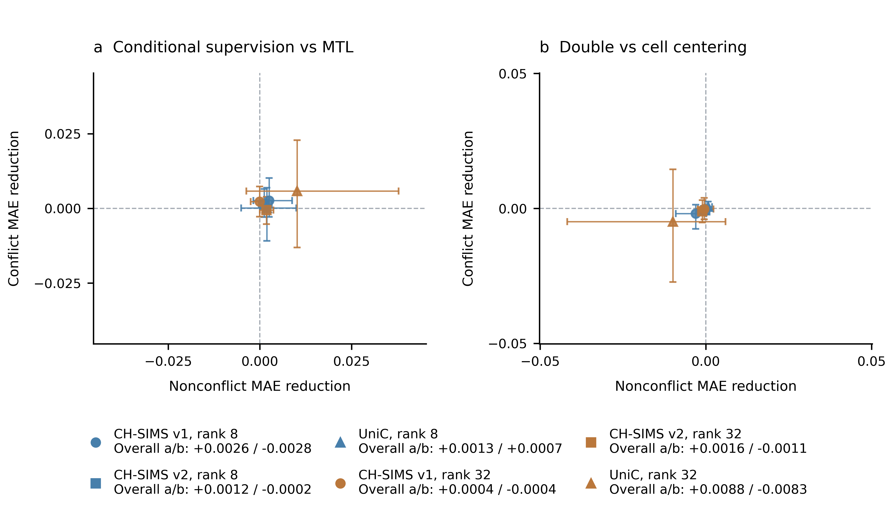
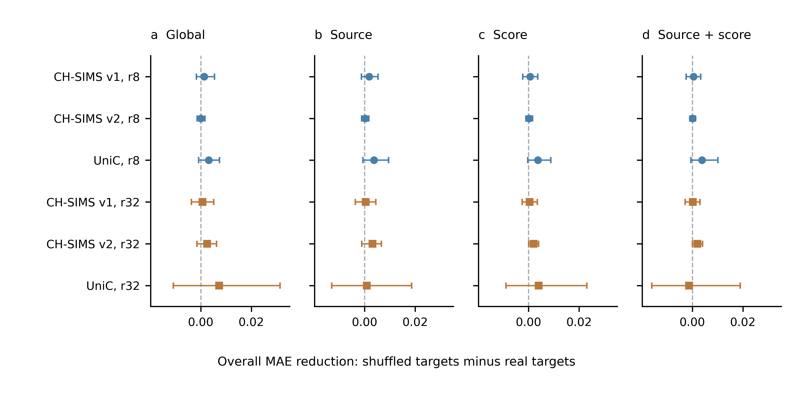

# 多模态情感差异监督：实验归档

本仓库整理 SMC / CSCWD 研究中值得保留的算法候选、真实实验结果和关键对照。当前主候选是 **来源—整体评分条件下的连续模态差异监督**（Stage151）。归档日期：2026-11-12。

**证据状态：探索性候选，不是已经确认的稳定提升或录用保证。** 三个队列、两种特征维度共六个设置，相对普通单模态多任务学习的平均 MAE 均下降，但六个 95% 区间均跨零。相对仅主任务是 5/6 设置改善。本文档保留全部六个设置，不只选表现最好的子集。

## 从哪里开始

1. [研究结果与局限](docs/REPORT_ZH.md)：研究问题、方法、完整结果与主张边界。
2. [实验目录](docs/EXPERIMENT_INDEX.md)：哪些是主候选，哪些是支撑或失败探索。
3. [固定实验协议](docs/protocols/STAGE151_PROTOCOL.md)：模型、损失、选择规则与对照。
4. [复现说明](docs/REPRODUCE.md)：无需数据的归档验证，以及授权数据上的训练入口。
5. [汇总结果 CSV](results/summary/candidate_results.csv) / [消融表](results/ablation/ablation_metrics.csv)。

## 仓库结构

```text
src/                         可移植的算法数值核心
scripts/train.py             单折、单种子、28 分支训练入口
scripts/verify_archive.py    原件哈希与汇总数字校验
configs/                     固定实验参数
tests/                       核心公式、梯度和原代码一致性检查
results/summary/             六设置结果、收益代价与打乱对照表
results/ablation/            消融实验结果及解释
results/provenance/          原件哈希与90组训练记录索引
figures/                     已有证据图：PDF / SVG / PNG
docs/protocols/              历史固定实验协议
archive/original_scripts/   实际使用的历史脚本原件，供追溯
data/README.md               数据获取边界与输入格式
```

## 候选的核心思想

整体情感相同不代表三个模态的情感构成相同。模型同时预测整体分数和三个单模态分数，并约束同来源、同整体评分内的模态相对差异。

对于辅助误差 `E = predicted_unimodal - human_unimodal`，条件损失为同一训练单元内 `E - mean_cell(E)` 的平均绝对值；单例单元不计入条件项。固定目标为 `L_task + 0.25 L_uni + 0.25 L_cond`。推理只使用特征。

| 队列 | 每模态 PCA 维数 | 普通多任务 MAE | 候选 MAE | MAE 降幅 |
|---|---:|---:|---:|---:|
| CH-SIMS v1 | 8 | 0.508094 | 0.505528 | +0.002565 |
| CH-SIMS v2 去重队列 | 8 | 0.341070 | 0.339869 | +0.001201 |
| UniC | 8 | 0.507953 | 0.506613 | +0.001340 |
| CH-SIMS v1 | 32 | 0.445185 | 0.444799 | +0.000386 |
| CH-SIMS v2 去重队列 | 32 | 0.325367 | 0.323750 | +0.001616 |
| UniC | 32 | 0.557293 | 0.548524 | +0.008769 |

完整区间见 CSV。三个来源互斥外折，五个种子；历史外折已经参与开发，不能当作新独立确认。不得直接与官方划分的文献数字排名。





## 快速检查

```bash
python scripts/verify_archive.py
python -m pip install -r requirements.txt
python -m unittest discover -s tests -v
python scripts/train.py --help
```

仓库不包含受限数据、逐样本标签、模型检查点、账号令牌或本机关机控制器。第三方 CACR / DLF 源码没有混入自有算法。CACR 目前只做过接口检查，尚未完成真实数据公平基线训练，不能列为已完成性能对比。

本次是实验代码与证据归档，不是提交版论文。数据与第三方软件遵守各自许可；本仓库尚未指定额外的开源再许可。
